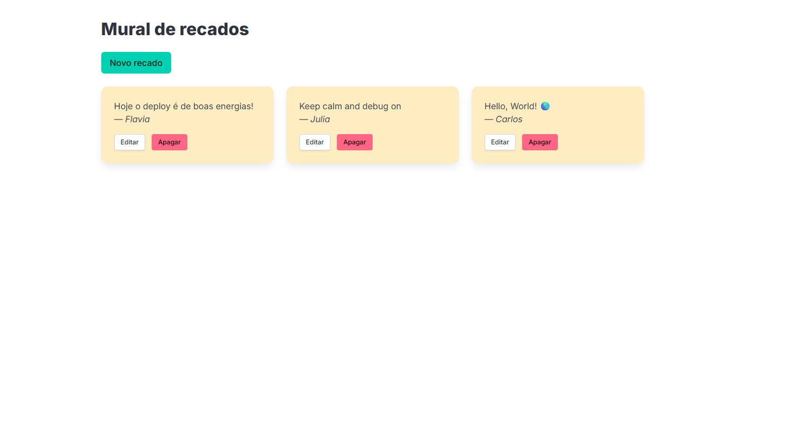
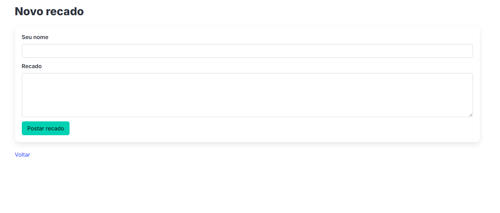
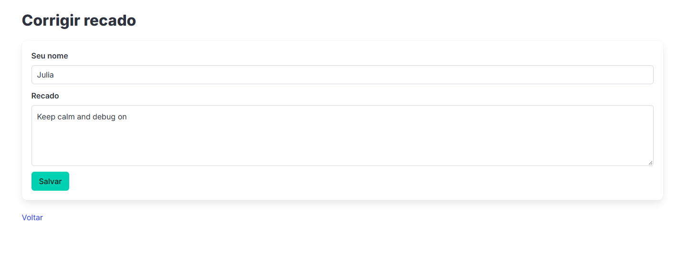

# 📝 Mural de Recados

Aplicação web desenvolvida durante um workshop do **Rails Girls**, iniciativa que incentiva a participação de mulheres na tecnologia por meio do aprendizado prático de programação.

O projeto utiliza **Ruby on Rails** para desenvolver uma aplicação de mural de recados, proporcionando uma experiência prática com o desenvolvimento web e o framework Ruby on Rails.

## 🎯 Objetivo

Colocar em prática os conhecimentos de desenvolvimento web adquiridos durante o workshop, explorando a estrutura de uma aplicação Ruby on Rails.

## 🛠️ Tecnologias utilizadas

- **Ruby**
- **Ruby on Rails**
- **SQLite3**
- **HTML e CSS** — para a estrutura e apresentação da interface, conforme implementadas no projeto.

## 📚 Aprendizados

- Introdução ao desenvolvimento web com Ruby on Rails.
- Familiarização com a estrutura de projetos Rails.
- Contato com ferramentas e tecnologias utilizadas no desenvolvimento de aplicações web.
- Participação em uma iniciativa de aprendizado e colaboração voltada para mulheres na tecnologia.

## 🚀 Como executar o projeto

### Pré-requisitos

- ruby-4.0.7
- Bundler.
- SQLite3.

### Instalação

1. Clone o repositório:

   ```bash
   git clone https://github.com/annaagabi/mural-de-recados.git
   ```

2. Acesse a pasta do projeto:

   ```bash
   cd mural-de-recados
   ```

3. Instale as dependências:

   ```bash
   bundle install
   ```

4. Configure e prepare o banco de dados:

   ```bash
   rails db:prepare
   ```

5. Inicie o servidor:

   ```bash
   rails server
   ```

6. Acesse a aplicação no navegador:

   http://localhost:3000

## 👩‍💻 Sobre o projeto

Este repositório reúne o código desenvolvido durante o workshop do **Rails Girls**, uma oportunidade de aprender na prática e explorar novas tecnologias no desenvolvimento de software.

**Repositório:** [mural-de-recados](https://github.com/annaagabi/mural-de-recados)

## 🖥️ Telas da aplicação

### 🏠 Tela inicial

Exibe os recados cadastrados no mural, com opções para editar ou excluir cada recado individualmente, além de um botão para criar um novo recado.



### ✏️ Criação de recado

Tela destinada à criação de novos recados para o mural.



### 📝 Edição de recado

Tela que permite editar as informações de um recado já cadastrado.



